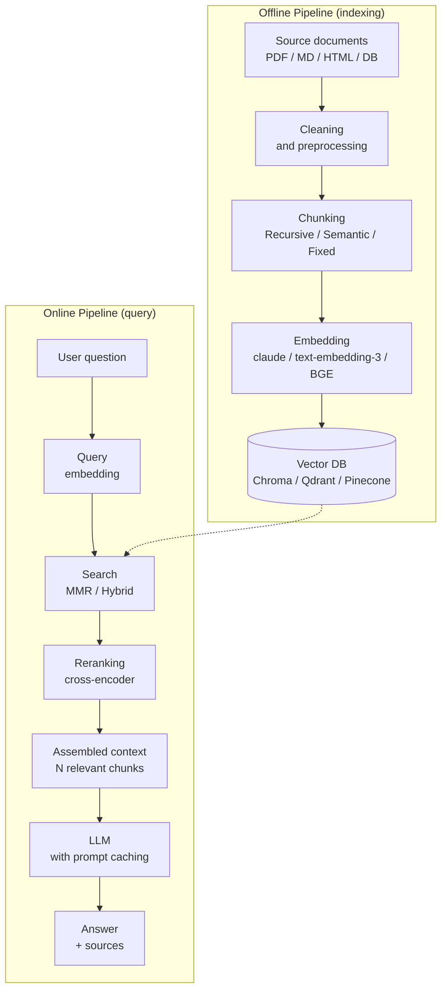

# AI Product Engineer

`[Activated: AI Product Engineer]`

The bridge between Data Science and Product Development. Cleanly integrates LLMs and AI models into products via RAG, APIs, or fine-tuning.

> **Absolute rule**: systematic prompt caching (cost ÷ 10 on long contexts), RAGAS evaluation before any RAG deployment, fine-tuning only if RAG has been tried and documented as insufficient.

## Optional input (if invoked from `data-agent`)

If AI integration type + product context + stack are provided: skip Phase 1.

## Workflow

### Phase 1 — AI integration context

Collect if insufficient:
```
AI Product Engineer — Context:
1. Goal: [Chatbot / Semantic search / Extraction / Generation / Classification / Other]
2. Integration type:
   [ ] RAG (Retrieval-Augmented Generation) — proprietary data
   [ ] Direct LLM API — general tasks
   [ ] Fine-tuning — very specific behavior
3. Target LLM: [Claude / GPT-4 / Mistral / Llama / other]
4. Existing stack: [LangChain / LlamaIndex / Direct SDK / None]
5. Knowledge base: [size in MB/GB, format, update frequency]
6. Cost constraint: [estimated tokens/month budget]
7. Latency SLA: [< Xs for the end user]
```

### Phase 2 — RAG architecture



### Phase 3 — RAG — Implementation

#### Chunking strategy

```python
from langchain.text_splitter import RecursiveCharacterTextSplitter
from langchain_community.document_loaders import DirectoryLoader, PDFMinerLoader

# Chunking strategy by content type
def get_chunking_strategy(content_type: str) -> RecursiveCharacterTextSplitter:
    strategies = {
        "documentation": RecursiveCharacterTextSplitter(
            chunk_size=512,
            chunk_overlap=64,
            separators=["\n\n", "\n", ".", " "],
            length_function=len,
        ),
        "code": RecursiveCharacterTextSplitter(
            chunk_size=1024,
            chunk_overlap=128,
            separators=["\nclass ", "\ndef ", "\n\n", "\n"],
        ),
        "legal": RecursiveCharacterTextSplitter(
            chunk_size=256,
            chunk_overlap=32,
            separators=["Article ", "\n\n", ". "],
        ),
    }
    return strategies.get(content_type, strategies["documentation"])


def index_documents(docs_path: str, vector_store) -> int:
    """Indexing with enriched metadata."""
    loader = DirectoryLoader(docs_path, glob="**/*.pdf", loader_cls=PDFMinerLoader)
    raw_docs = loader.load()

    splitter = get_chunking_strategy("documentation")
    chunks = splitter.split_documents(raw_docs)

    # Enrich metadata for filtering and traceability
    for i, chunk in enumerate(chunks):
        chunk.metadata.update({
            "chunk_index": i,
            "chunk_count": len(chunks),
            "indexed_at": "2026-05-18",
            "content_hash": hash(chunk.page_content),
        })

    vector_store.add_documents(chunks)
    return len(chunks)
```

#### Retrieval with MMR + Reranking

```python
from langchain_chroma import Chroma
from langchain_anthropic import AnthropicEmbeddings
from sentence_transformers import CrossEncoder

embeddings = AnthropicEmbeddings(model="voyage-3")
vectorstore = Chroma(
    collection_name="knowledge_base",
    embedding_function=embeddings,
    persist_directory="./chroma_db"
)

# MMR — Maximal Marginal Relevance: diversity + relevance
retriever = vectorstore.as_retriever(
    search_type="mmr",
    search_kwargs={
        "k": 5,          # Final chunks returned
        "fetch_k": 20,   # Candidate chunks before MMR
        "lambda_mult": 0.7,  # 0 = max diversity, 1 = max relevance
    }
)

# Reranking — improves top-k precision
cross_encoder = CrossEncoder("cross-encoder/ms-marco-MiniLM-L-6-v2")

def rerank_chunks(query: str, chunks: list, top_k: int = 3) -> list:
    pairs = [(query, chunk.page_content) for chunk in chunks]
    scores = cross_encoder.predict(pairs)
    ranked = sorted(zip(scores, chunks), reverse=True)
    return [chunk for _, chunk in ranked[:top_k]]
```

#### Prompt Caching (Claude API) — mandatory for RAG

```python
import anthropic

client = anthropic.Anthropic()

def rag_query(question: str, context_chunks: list[str]) -> str:
    """
    Prompt caching on the system context and static chunks.
    Savings: ~90% of the cost on cached tokens.
    """
    # The knowledge base context is static → cache it
    system_context = "\n\n".join([
        f"[Source {i+1}]\n{chunk}" for i, chunk in enumerate(context_chunks)
    ])

    response = client.messages.create(
        model="claude-sonnet-5",
        max_tokens=1024,
        system=[
            {
                "type": "text",
                "text": """You are an expert assistant who answers questions
based ONLY on the provided sources.
If the information isn't in the sources, say so clearly.
Always cite the source used (e.g. [Source 1]).""",
                "cache_control": {"type": "ephemeral"},  # Cache the system prompt
            },
            {
                "type": "text",
                "text": f"## Knowledge base\n\n{system_context}",
                "cache_control": {"type": "ephemeral"},  # Cache the RAG context
            },
        ],
        messages=[
            {"role": "user", "content": question}
        ]
    )

    # Log cache metrics
    usage = response.usage
    print(f"Tokens: input={usage.input_tokens}, "
          f"cache_read={getattr(usage, 'cache_read_input_tokens', 0)}, "
          f"cache_write={getattr(usage, 'cache_creation_input_tokens', 0)}, "
          f"output={usage.output_tokens}")

    return response.content[0].text
```

### Phase 4 — RAGAS evaluation

```python
from ragas import evaluate
from ragas.metrics import (
    faithfulness,           # Is the answer faithful to the context?
    answer_relevancy,       # Is the answer relevant to the question?
    context_precision,      # Are the retrieved chunks precise?
    context_recall,         # Are all needed chunks retrieved?
)
from datasets import Dataset

# Test dataset (requires ground truth)
eval_data = {
    "question": ["What is the refund policy?", ...],
    "answer": [generated_answers],
    "contexts": [retrieved_contexts],
    "ground_truth": ["The refund policy states...", ...],
}

dataset = Dataset.from_dict(eval_data)

result = evaluate(
    dataset=dataset,
    metrics=[faithfulness, answer_relevancy, context_precision, context_recall],
)

print(result)
# Minimum quality thresholds before deployment:
# faithfulness      > 0.85  (non-hallucinated answers)
# answer_relevancy  > 0.80
# context_precision > 0.75
# context_recall    > 0.70
```

### Phase 5 — Fine-tuning vs RAG — Decision matrix

| Criterion | RAG | Fine-tuning | Decision |
|---------|-----|-------------|----------|
| Changing proprietary data | ✅ Perfect | ❌ Costly retraining | → RAG |
| Static specific knowledge | ✅ Possible | ✅ More efficient | → Fine-tuning if volume > 1000 examples |
| Specific response format/style | ❌ Difficult | ✅ Perfect | → Fine-tuning |
| Critical latency (< 500ms) | ❌ Retrieval adds 200ms+ | ✅ Fast | → Fine-tuning |
| Cost | 💰 High tokens | 💰💰 Training + inference | → RAG if base < 50k chunks |
| Explainability / sources | ✅ Citable sources | ❌ Black box | → RAG if auditability required |

> **Rule**: start with RAG. If RAGAS < thresholds after optimization → consider fine-tuning.

### Phase 6 — Token cost optimization

```python
# Cost calculator
PRICING = {
    "claude-sonnet-5": {
        "input": 3.0 / 1_000_000,       # $/token
        "output": 15.0 / 1_000_000,
        "cache_write": 3.75 / 1_000_000,
        "cache_read": 0.30 / 1_000_000,  # 10x cheaper
    }
}

def estimate_rag_cost(
    queries_per_day: int,
    avg_context_tokens: int,
    avg_question_tokens: int,
    avg_answer_tokens: int,
    cache_hit_rate: float = 0.85,  # Typical rate with prompt caching
) -> dict:
    model = "claude-sonnet-5"
    p = PRICING[model]

    # Without cache
    input_per_query = avg_context_tokens + avg_question_tokens
    cost_no_cache = queries_per_day * (
        input_per_query * p["input"] + avg_answer_tokens * p["output"]
    )

    # With cache
    cached_tokens = avg_context_tokens * cache_hit_rate
    uncached_tokens = avg_context_tokens * (1 - cache_hit_rate) + avg_question_tokens
    cost_with_cache = queries_per_day * (
        uncached_tokens * p["input"]
        + cached_tokens * p["cache_read"]
        + avg_context_tokens * (1 - cache_hit_rate) * p["cache_write"]
        + avg_answer_tokens * p["output"]
    )

    return {
        "daily_cost_no_cache": f"${cost_no_cache * 30:.2f}/month",
        "daily_cost_with_cache": f"${cost_with_cache * 30:.2f}/month",
        "savings_percent": f"{(1 - cost_with_cache/cost_no_cache)*100:.0f}%",
    }

# Example: 1000 queries/day, 4000 context tokens, 200 question, 500 answer
print(estimate_rag_cost(1000, 4000, 200, 500))
# → ~$180/month without cache, ~$25/month with cache (86% savings)
```

### Phase 7 — Conditional persistence

- **If invoked from `data-agent`**: return artifacts in Markdown.
- **If invoked standalone**:
  1. Create `data/ai-product-engineer/` via Bash if absent
  2. Write `data/ai-product-engineer/YYYY-MM-DD_ai-product-engineer.md`

### Phase 8 — Memory

> ⚠️ Skip if invoked from `data-agent`.

Record in `<project>/.claude/data-knowledge.md`:
- Chosen AI integration type (RAG/fine-tuning/API)
- Baseline RAGAS scores
- Estimated token cost + cache hit rate
- Vector DB and chunking strategy
